<div align="center">

  

  <p align="center">
    <strong>Systems, Android &amp; AI Swarms Engineer</strong><br>
    <em>Architecting rootless mobile networking, creator telemetry &amp; autonomous multi-agent workflows.</em>
  </p>

  <p align="center">
    <a href="https://github.com/Sourish25"></a>
    &nbsp;
    <a href="https://github.com/Sourish25/SourZap"></a>
    &nbsp;
    <a href="https://github.com/Sourish25/MineBucks"></a>
  </p>

  <p align="center">
    <code>🟢 Open for Systems &amp; Swarm Architecture Collaboration</code> • <code>📍 India (IST / UTC+5:30)</code>
  </p>

</div>

---

### 💻 System Telemetry &amp; Runtime Specs

```yaml
user: Sourish (@Sourish25)
role: Systems, Mobile & AI Engineer
location: India (IST / UTC+5:30)
status: "Building resilient mobile networking & AI swarms"

core_domains:
  android_systems:
    - Rootless VPN & DPI circumvention (SourZap)
    - Creator revenue analytics & scraping (MineBucks)
    - Jetpack Compose, Material 3, Room, WorkManager, Glance
  ai_agentic_swarms:
    - Directed Cyclic Graphs via LangGraph (OrgaNexus)
    - Voice-first MSME ledger with Whisper (BizAgent)
  fullstack_systems:
    - Next.js 14, FastAPI, TypeScript, Python, Docker

interests:
  - Deep Packet Inspection (DPI)
  - Autonomous Multi-Agent Swarms
  - Manhwa Parsing & Archival
  - Game Modding & Internals
```

---

### 📻 Live Audio Engine // Deep Work Soundtrack

<div align="center">
  <a href="https://open.spotify.com/playlist/37i9dQZF1DXdLTE75A3Kki" target="_blank" title="Launch Synthwave Focus Stream on Spotify">
    
  </a>

  <br><br>

  <p align="center">
    <a href="https://open.spotify.com/playlist/37i9dQZF1DXdLTE75A3Kki" target="_blank">
      
    </a>
    &nbsp;&nbsp;
    <a href="https://www.youtube.com/watch?v=jfKfPfyJRdk" target="_blank">
      
    </a>
    &nbsp;&nbsp;
    <a href="https://www.youtube.com/watch?v=4xDzrJKXOOY" target="_blank">
      
    </a>
  </p>
</div>

---

### 🚀 Flagship Engineering Showcases

#### ⚡ [SourZap](https://github.com/Sourish25/SourZap) — Rootless DPI Circumvention &amp; Network Monitor for Android
<p>
  
  
  
  
</p>

* Operates entirely in user-space via Android `VpnService` without requiring root, Magisk, or Termux.
* Implements **TLS ClientHello Record Split2**, HTTP Host desynchronization, instant ICMP QUIC rejection, and RFC 4443 Happy Eyeballs fallback.
* Layer-3 zero-allocation packet slicing with 8-socket protected UDP datagram pools for BitTorrent swarms.
* Multi-stream broadband diagnostic benchmark &amp; thread-safe 0ms DoH caching across Cloudflare, Google, and Quad9.

👉 **[Explore SourZap Repository →](https://github.com/Sourish25/SourZap)**

<br>

#### 📈 [MineBucks](https://github.com/Sourish25/MineBucks) — Unified Creator Revenue Analytics &amp; Monitoring Suite
<p>
  
  
  
  
</p>

* Aggregates developer revenue, downloads, and rewards from both Modrinth and CurseForge into a single native dashboard.
* Custom headless WebKit browser engine spoofing Mobile User-Agents to safely bypass Google OAuth login blocks locally.
* Automated background synchronizations via `WorkManager` respecting Android Doze mode (0% idle battery consumption).
* Historical balance tracking via `Room`, interactive `Vico` revenue charts, and `Glance` home-screen widgets.

👉 **[Explore MineBucks Repository →](https://github.com/Sourish25/MineBucks)**

<br>

#### 🤖 [Bharat Biz-Agent](https://github.com/Sourish25/BizAgent) — Voice-First AI Munim for Indian MSMEs
<p>
  
  
  
  
</p>

* Enables small business owners to manage credit ledgers (Udhaar), inventory, and expenses using natural Hinglish voice commands.
* On-device Whisper STT paired with Google Gemini 3.0 reasoning extracts customers, items, and transactions with contextual memory.
* Vision-based invoice &amp; UPI screenshot entry with automated expense categorization.
* Automated one-click payment reminders dispatched seamlessly via WhatsApp and Email APIs.

👉 **[Explore BizAgent Repository →](https://github.com/Sourish25/BizAgent)**

<br>

#### 🌌 [OrgaNexus](https://github.com/Sourish25/OrgaNexus) — Autonomous Multi-Agent Swarm for Event Logistics
<p>
  
  
  
  
</p>

* Directed Cyclic Graph (DCG) multi-agent architecture dividing tasks across Supervisor, Scheduler, Comms, and Logistics nodes.
* Dynamic *Pulse Drift* simulation handles real-time logistical emergencies by automatically recalculating schedules on the fly.
* Personalized schedule email blasting with CSV directory ingestion and custom SMTP verification feedback loops.
* Containerized microservices orchestration running FastAPI backend and Next.js 14 frontend with hot-reloading.

👉 **[Explore OrgaNexus Repository →](https://github.com/Sourish25/OrgaNexus)**

---

### 🛠️ Technical Arsenal &amp; Ecosystem

<div align="center">
  
</div>

<br>

| Domain | Core Technologies &amp; Frameworks |
| :--- | :--- |
| **Android &amp; Mobile** | Kotlin, Jetpack Compose, Material 3 Expressive, Android VpnService, Room, WorkManager, Glance, Retrofit, Coroutines/Flow |
| **AI &amp; Agent Swarms** | LangGraph (Cyclic Graphs), Google Gemini API, OpenAI Whisper (Local STT), Multi-Agent Planning |
| **Web &amp; Full-Stack** | Next.js 14, React, TypeScript, FastAPI, Python, TailwindCSS, Framer Motion |
| **Systems &amp; DevOps** | Docker &amp; Docker Compose, Linux, Git, SQLite, Gradle, TCP/IP &amp; Packet Desynchronization |

---

### 📊 Live GitHub Mainframe Analytics

<div align="center">
  <table border="0" cellspacing="0" cellpadding="0">
    <tr>
      <td valign="top" align="center" style="padding: 8px;">
        
      </td>
      <td valign="top" align="center" style="padding: 8px;">
        
      </td>
    </tr>
  </table>
</div>

---

### 🌐 Transmit &amp; Connect

<div align="center">
  <p align="center">
    <a href="https://github.com/Sourish25">
      
    </a>
    &nbsp;&nbsp;
    <a href="mailto:Sourish25@users.noreply.github.com">
      
    </a>
  </p>

  <p align="center">
    <sub>Crafted with engineering focus, precision &amp; caffeine • 2026</sub>
  </p>
</div>
